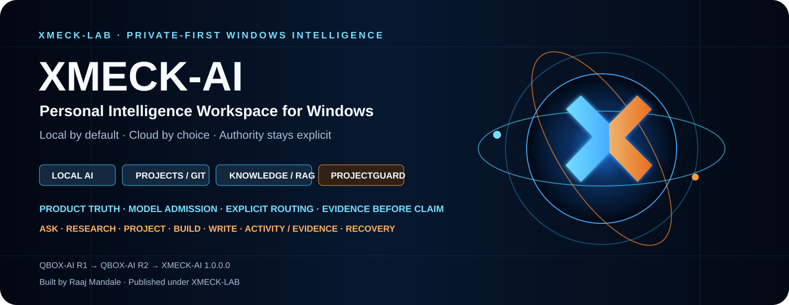
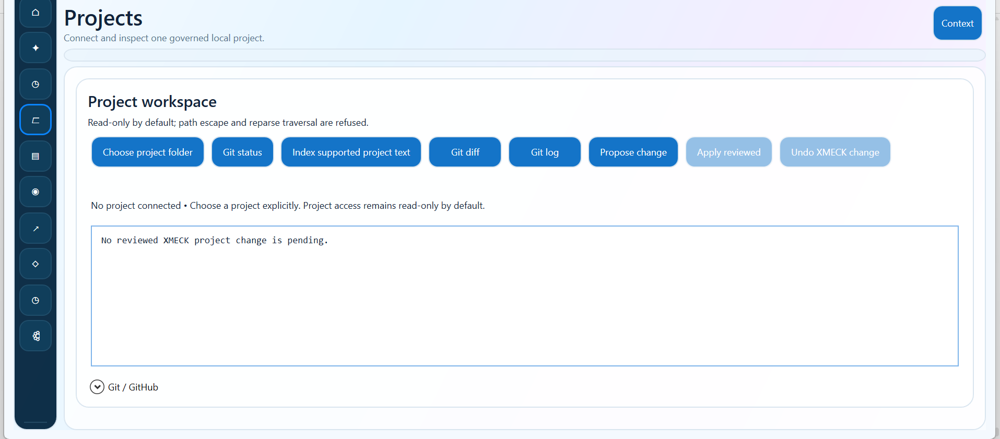
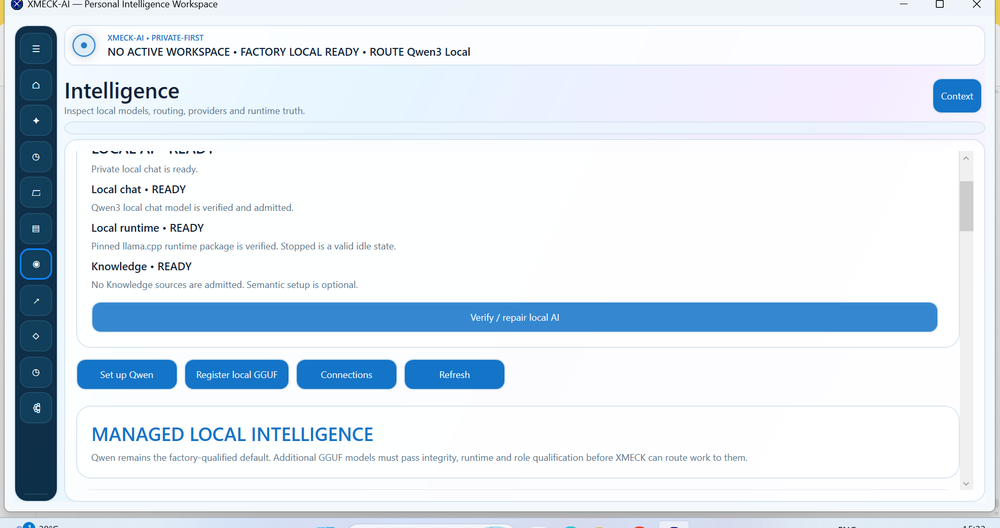
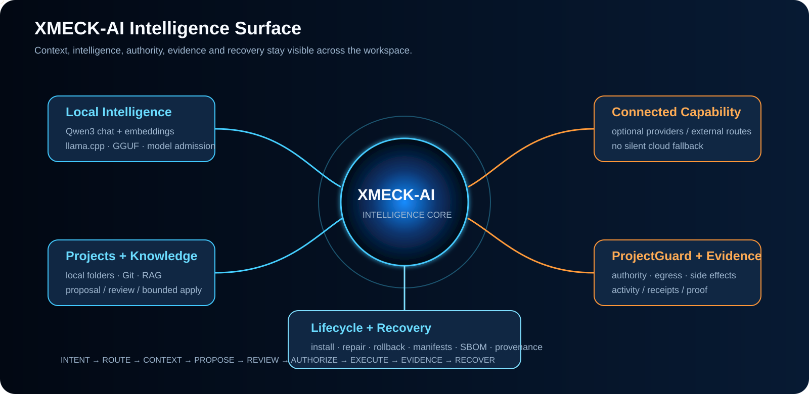
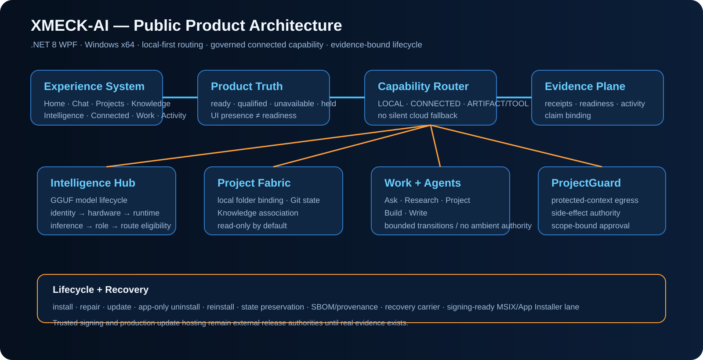
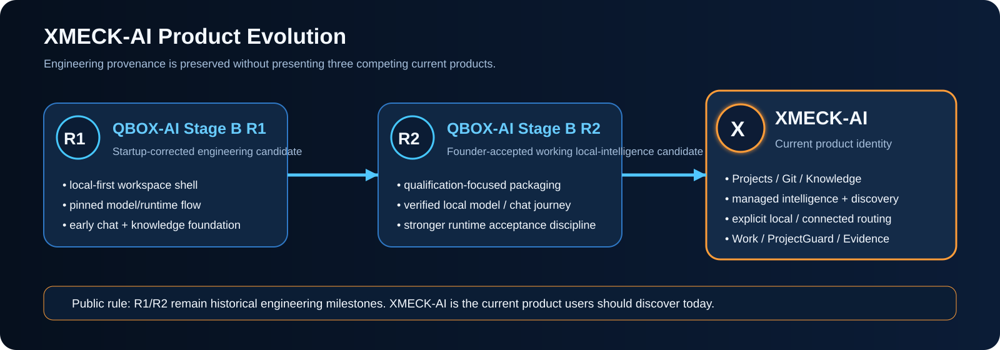

<p align="center">
  
</p>

<h1 align="center">🧠 XMECK-AI</h1>

<p align="center">
  <strong>Your AI workspace. Your models. Your projects. Your control.</strong><br>
  Private-first intelligence for conversations, knowledge, engineering projects and governed work.
</p>

<p align="center">
  
  
  
  
</p>

<p align="center">
  <a href="#-explore-the-workspace"><strong>Explore</strong></a> &nbsp; • &nbsp;
  <a href="#-what-you-can-do"><strong>Capabilities</strong></a> &nbsp; • &nbsp;
  <a href="#-your-models-your-choice"><strong>Models</strong></a> &nbsp; • &nbsp;
  <a href="#-evaluate-xmeck-ai"><strong>Evaluate</strong></a> &nbsp; • &nbsp;
  <a href="docs/PUBLIC_EVIDENCE_INDEX.md"><strong>Evidence</strong></a>
</p>

<p align="center"><em>Local by default. Cloud by choice. Authority stays with you.</em></p>

---

## ✨ Intelligence that works around your world

**XMECK-AI is a Windows intelligence workspace—not another language model.** It brings together local AI conversation, your files and knowledge, real project context, model choice, useful outputs and control over actions.

Start with a conversation. Bring in a project. Search your own knowledge. Explore compatible models. Ask AI to explain, research, write or propose changes—and keep decisions about accessing data and changing files visible.

> **The model supplies intelligence. You supply the context, permissions and final authority.**

## 🎬 Explore the workspace

<p align="center">
  
</p>
<p align="center"><sub>💬 <strong>CHAT</strong> — A continuous conversation canvas using a qualified local model.</sub></p>

<p align="center">
  
  
</p>
<p align="center"><sub>📁 <strong>PROJECTS</strong> — Work with owned files and local Git. &nbsp; 🧠 <strong>INTELLIGENCE</strong> — Know which models can really run.</sub></p>

<p align="center">
  
</p>
<p align="center"><sub>Illustrative system architecture; actual product behavior is defined by qualified runtime evidence.</sub></p>

## ⚡ What you can do

| Workspace | Your everyday outcome |
| :--- | :--- |
| 💬 **Chat & Conversations** | Ask questions using a qualified local model, stream replies and return to conversations. |
| 📁 **Projects & Git** | Open a local project, inspect supported files and Git changes, and prepare reviewed updates. |
| 📚 **Knowledge & RAG** | Index supported local knowledge and retrieve relevant context with available references. |
| 🧠 **Models & Intelligence** | Discover GGUF models, import them and qualify their runtime and task eligibility. |
| 🌐 **Connected Intelligence** | Configure optional providers intentionally; external routing is never an invisible fallback. |
| 🛠️ **Work & Bounded Agents** | Use Ask, Research, Project, Build and Write modes within authorized capabilities. |
| 🛡️ **ProjectGuard** | Keep protected context and side-effect decisions under explicit user control. |
| 🧾 **Activity, Artifacts & Recovery** | Inspect supported operations, generated work and lifecycle evidence. |

**Built for a practical workflow:** Chat → bring your project or knowledge → choose intelligence → review the outcome → authorize supported actions.

The current Windows engineering candidate has defined qualification boundaries. Not every discovered model, optional provider or agent action is automatically usable. [See exact capabilities and limits →](docs/PUBLIC_CLAIMS_MATRIX.md)

## 🔐 What makes XMECK-AI different?

Local chat, RAG and model APIs already exist across the AI ecosystem. **XMECK-AI's engineering focus is the system around them.**

**🧭 Model choice with real readiness** — An available model file is not the same as a verified model route. Identity, hardware fit, runtime loading and role qualification are distinct steps.

**🛡️ Permission before action** — AI can propose project changes without automatically earning permission to apply them. ProjectGuard separates knowledge, access, approval and supported execution.

**📁 Your projects remain yours** — Work with user-owned folders, model files and knowledge rather than surrendering them to an application-managed cloud account.

**🔎 Know what really happened** — Readiness, activity, evidence and recovery are first-class parts of the workspace, not just decorative badges.

<p align="center">
  
</p>

```text
YOUR QUESTION OR GOAL
        ↓
CHOSEN MODEL + PROJECT / KNOWLEDGE CONTEXT
        ↓
ANSWER · RESEARCH · PROPOSAL · ARTIFACT
        ↓
PROJECTGUARD REVIEW + EXPLICIT AUTHORITY
        ↓
SUPPORTED ACTION + ACTIVITY / EVIDENCE
```

*This is a bounded Windows software architecture, not a claim of universal operating-system enforcement, unrestricted agent control or independent security certification.*

## 🧠 Your models. Your choice.

**Local-first reference:** Qwen3-8B Q4_K_M for chat, Qwen3-Embedding-0.6B Q8_0 for retrieval, with a pinned llama.cpp runtime. Model weights are **not** bundled in this public repository.

**Beyond one model:** The Intelligence workspace supports discovering and importing compatible GGUF artifacts. Each model must earn readiness for its intended role; a model appearing in search results does not mean it can already answer.

**Connected by choice:** External AI providers are optional and require explicit configuration and qualification. Opening ChatGPT, Gemini or another assistant in a browser is a handoff—not an integrated provider route.

[Explore models and routing →](docs/MODELS_AND_ROUTING.md)

## 🚀 Evaluate XMECK-AI

**XMECK-AI 1.0.0.0** is a real **single-user Windows x64 engineering candidate**, with local intelligence and bounded project/knowledge workflows. This is not yet a trusted signed commercial distribution.

| Start here | What you will find |
| :--- | :--- |
| 📘 **[Product facts](docs/PRODUCT_FACTS.md)** | Current application and runtime scope |
| 🧪 **[Engineering evidence](docs/PUBLIC_EVIDENCE_INDEX.md)** | Public qualification records |
| 🖥️ **[Windows evaluation guide](DOWNLOAD_XMECK_AI_1.0.0.0.md)** | Installation, verification and recovery information |
| 🧾 **[Release status](docs/RELEASE_BOUNDARY.md)** | External signing, hosting and admission boundaries |
| 🔍 **[Capabilities and limits](docs/PUBLIC_CLAIMS_MATRIX.md)** | What is qualified, conditional or unavailable |

Public promotion of historical direct-download ZIPs is suspended during distribution review. This README does not remove the existing files or imply a new binary has passed qualification.

## 🏛️ Engineering that grows with the product

XMECK-AI evolved from the **QBOX-AI Stage B** Windows engineering foundation into a unified personal intelligence workspace. Version **1.0.0.0** is the first consolidated product identity—not a claim that the complete long-term vision is finished.

<p align="center">
  
</p>

**Built with:** .NET 8 / WPF · Windows x64 · llama.cpp · GGUF model admission · local project/knowledge systems · governed work and evidence.

**Designed boundaries:** Local by default, no silent cloud fallback, explicit project authority, user-owned resources and verifiable readiness.

The V1 scope does **not** include unrestricted computer control, guaranteed third-party provider readiness, multi-user enterprise hosting, mobile/macOS/Linux qualification or independent security certification.

[Architecture](docs/ARCHITECTURE.md) · [Engineering provenance](docs/ENGINEERING_PROVENANCE.md) · [Product evolution](docs/PRODUCT_EVOLUTION.md) · [Release boundaries](docs/RELEASE_BOUNDARY.md)

---

<p align="center">
  <strong>Built by Raaj Mandale — Systems Architect</strong><br>
  Published under <a href="https://github.com/XMECK-LAB"><strong>XMECK-AI LAB</strong></a><br><br>
  <strong>Your intelligence. Local by default. Cloud by choice.</strong>
</p>
