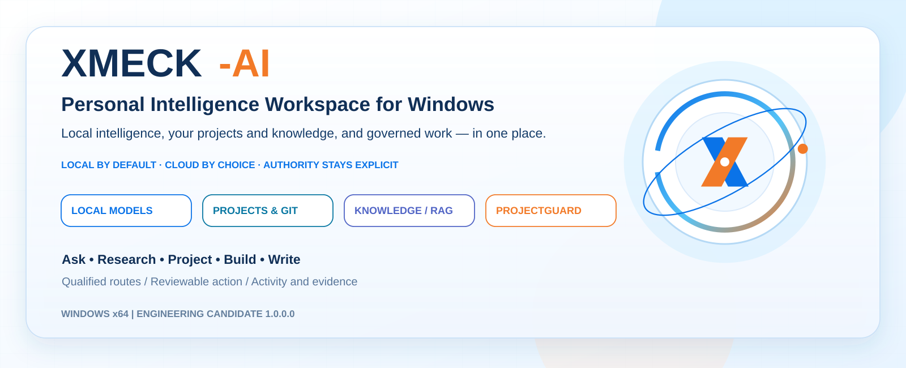
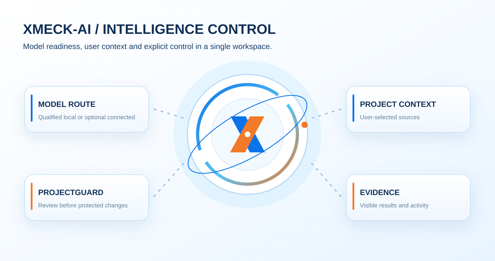
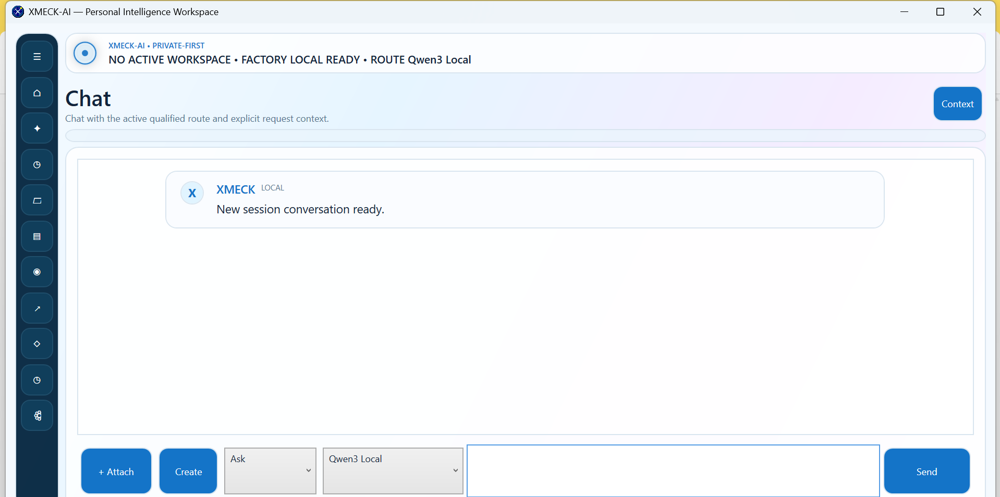
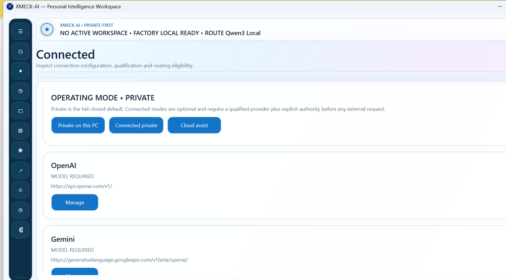
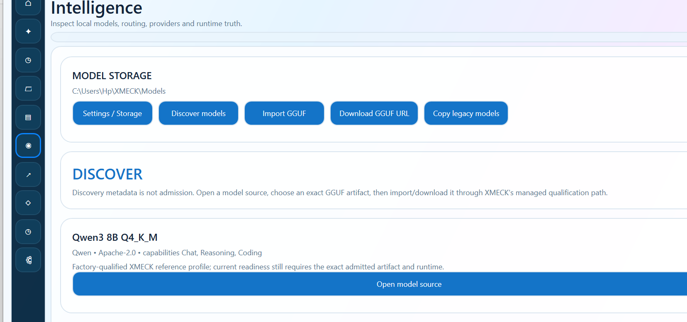
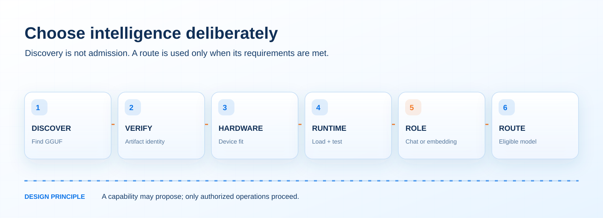
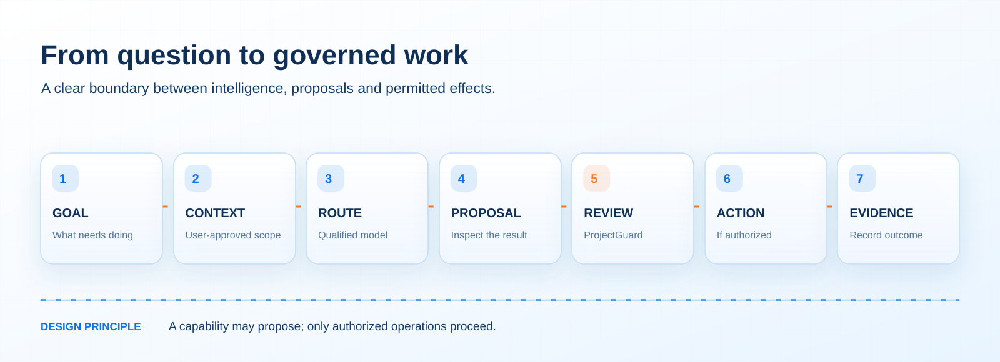
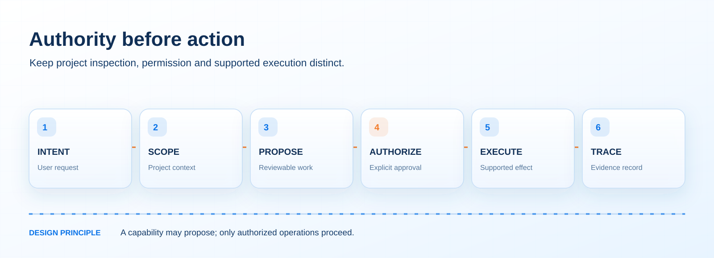
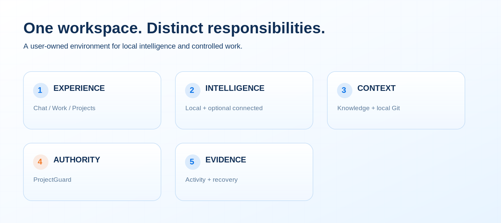

  

<h1 align="center">XMECK-AI</h1>

<strong>One workspace for AI, knowledge and real project work.</strong> 
Choose your intelligence. Bring your context. Keep authority over what happens next.

  
  
  

<a href="#-the-workspace">Workspace</a> ·
<a href="#-what-you-can-do">Capabilities</a> ·
<a href="#-models-you-choose">Models</a> ·
<a href="#-review-before-action">ProjectGuard</a> ·
<a href="#-evaluate-xmeck-ai">Evaluate</a> ·
<a href="#-engineering-and-evidence">Evidence</a>

---

## ✨ Intelligence around your work

**XMECK-AI is a private-first personal intelligence workspace for Windows.** It brings together conversations, models, local knowledge, software projects, and supported AI-assisted work in one application.

You can ask a question, explore files from a chosen project, retrieve knowledge from admitted sources, or prepare a reviewed change. The software makes the **model route, context and authority** explicit rather than treating every capability as automatically available.

**Why it exists:** A language model is only one part of useful work. The other parts are your files, tools, decisions, and the ability to inspect what actually happened. XMECK-AI is designed to connect those parts while keeping the user in control.

> **AI may propose. You decide what gets accessed, shared or changed.**

## 🎬 The workspace

<strong>CHAT</strong> — A local conversation workspace. The screenshot shows a new session, not a generated-answer performance demonstration.

<strong>PROJECTS</strong> — Local folder and Git operations. &nbsp; <strong>INTELLIGENCE</strong> — Model and runtime readiness.

## ⚡ What you can do

| Workspace | What it enables |
| :--- | :--- |
| **💬 Chat & Conversations** | Chat using a qualified local reference model, receive streaming responses and continue saved conversations. |
| **📁 Projects & Git** | Open your own folder, inspect supported files and local Git state, and prepare reviewed changes. |
| **📚 Knowledge / RAG** | Add supported local documents, build retrieval context and inspect available source references. |
| **🧠 Models & Runtimes** | Discover or import GGUF models, verify artifacts and check whether a model can run its intended role. |
| **🌐 Connected Intelligence** | Configure optional AI providers. Browser handoffs and genuinely integrated API routes are identified separately. |
| **🛠️ Work & Agents** | Use Ask, Research, Project, Build and Write within bounded tool and permission capabilities. |
| **🛡️ ProjectGuard** | Review protected-context access, external transfers and supported actions before side effects. |
| **🧾 Activity & Recovery** | Inspect supported action records, artifacts, diagnostics and lifecycle evidence. |

**One workspace, several ways to work:** start with a conversation, bring relevant project or knowledge context, choose a qualified intelligence route and inspect the result. Not all models, connected providers or tools are qualified on every device.

## 🧠 Models you choose

**Local by default.** The current qualified reference uses **Qwen3-8B Q4_K_M** with a pinned **llama.cpp** runtime. **Qwen3-Embedding-0.6B Q8_0** is the reference for semantic retrieval. Model weights are user-supplied, not included in the GitHub repository.

**More models, without misleading readiness.** Compatible GGUF files can be discovered and imported. XMECK-AI checks identity, hardware eligibility, runtime loading and the model's intended role before declaring a route ready.

**Cloud by choice.** Optional provider configurations are explicit and subject to credentials and live qualification. Opening a provider's website is a browser convenience—not an XMECK-managed API integration. There is no claimed silent cloud fallback.

[Models & routing details →](docs/MODELS_AND_ROUTING.md)

## 🛡️ Review before action

**ProjectGuard is the boundary between AI assistance and permission to act.** A model may suggest a change, but supported file-changing or data-transfer operations remain subject to the applicable project scope and explicit authority.

XMECK-AI's design principle is straightforward: **capability is not permission**. Its current implementation has defined software-level boundaries; it does not claim complete host isolation or unrestricted autonomous computer control.

## 🏛️ Engineering and evidence

The Windows application is built with **.NET 8 / WPF**, with an owned intelligence layer and separate responsibilities for project context, model admission, governed work, evidence and recovery.

The engineering decisions behind XMECK-AI include:
- **Product Truth:** distinguish ready, held and unavailable capabilities rather than using one misleading status.
- **Model admission:** validate a model's identity, runtime and task role before routing work to it.
- **User-owned context:** keep project folders, knowledge sources and models within declared ownership boundaries.
- **Explicit authority:** separate analysis and proposed work from consequential execution.
- **Inspectable evidence:** connect supported activity, artifacts and recovery to recorded product state.

[Technical architecture](docs/ARCHITECTURE.md) · [Public evidence index](docs/PUBLIC_EVIDENCE_INDEX.md) · [Product facts](docs/PRODUCT_FACTS.md) · [Claims matrix](docs/PUBLIC_CLAIMS_MATRIX.md)

## 🧬 Engineering lineage

XMECK-AI grew from the **QBOX-AI Stage B** Windows engineering foundation. **XMECK-AI 1.0.0.0** is the current consolidated product identity, combining local intelligence, project and knowledge work, explicit routing, ProjectGuard and lifecycle evidence.

This is its first public engineering candidate—not a claim that the longer-term platform vision is finished.

## 🚀 Evaluate XMECK-AI

**Current availability: Windows x64 engineering candidate.** The application has an internally qualified local reference path, but trusted public code signing, production update hosting, and some live provider/account integrations remain outside the admitted boundary.

| Evaluation resource | Purpose |
| :--- | :--- |
| **[Windows evaluation guide](DOWNLOAD_XMECK_AI_1.0.0.0.md)** | Setup, verification and recovery instructions |
| **[SHA-256 record](XMECK_AI_1.0.0.0_SHA256.txt)** | Verify the existing candidate artifact |
| **[Release boundary](docs/RELEASE_BOUNDARY.md)** | Current admission and external dependencies |
| **[Public claims matrix](docs/PUBLIC_CLAIMS_MATRIX.md)** | Qualified, contract-only, held and future capabilities |

The README does not promote historical direct-download ZIP packages. It makes no claim of inventing a foundation model, universal provider compatibility, multi-user enterprise hosting, independently certified security, cross-platform parity or best-in-class inference performance.

## 🌐 Built within XMECK-LAB

**[Raaj Mandale](https://github.com/raajmandale) — Systems Architect**  
**[XMECK-LAB](https://github.com/XMECK-LAB) — Public software and engineering organization**

XMECK-AI reflects work across local intelligence, execution systems, user-controlled computing and evidence-driven engineering.

It is one of several distinct XMECK-LAB engineering lines:
- **[XMECK-AI](https://github.com/XMECK-LAB/XMECK-AI)** — Private-first Windows intelligence workspace.
- **[XRECONY](https://github.com/XMECK-LAB/XRECONY)** — Structural understanding and reconstruction of readable data.
- **[TRANSCRIPT / KAVACH](https://github.com/XMECK-LAB/TRANSCRIPT)** — Governed execution and continuity-bound authority reference.

These relationships express the engineering ecosystem, not a claim that all three products are fully integrated.

<strong>Your intelligence. Local by default. Cloud by choice.</strong> Clear boundaries · Reviewable work · Evidence before claims

